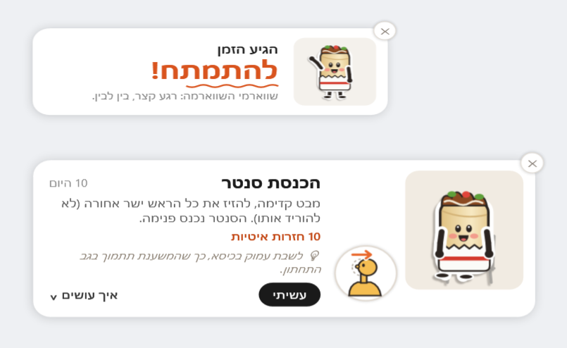
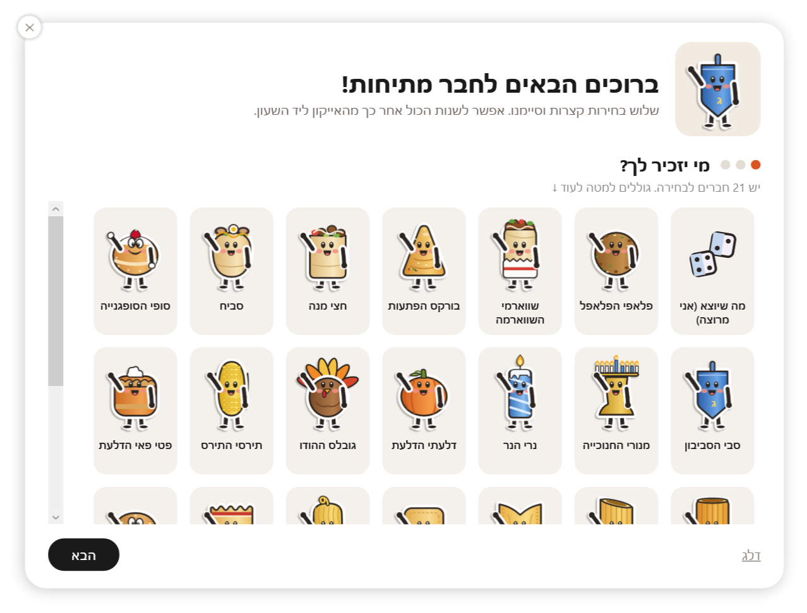
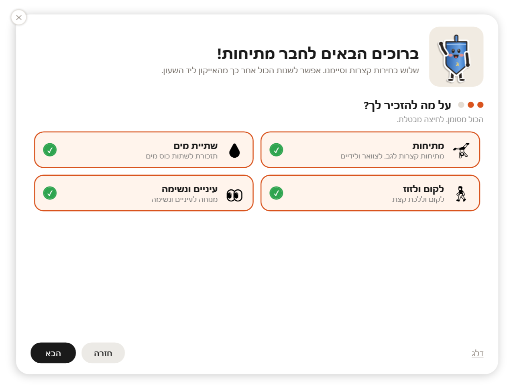
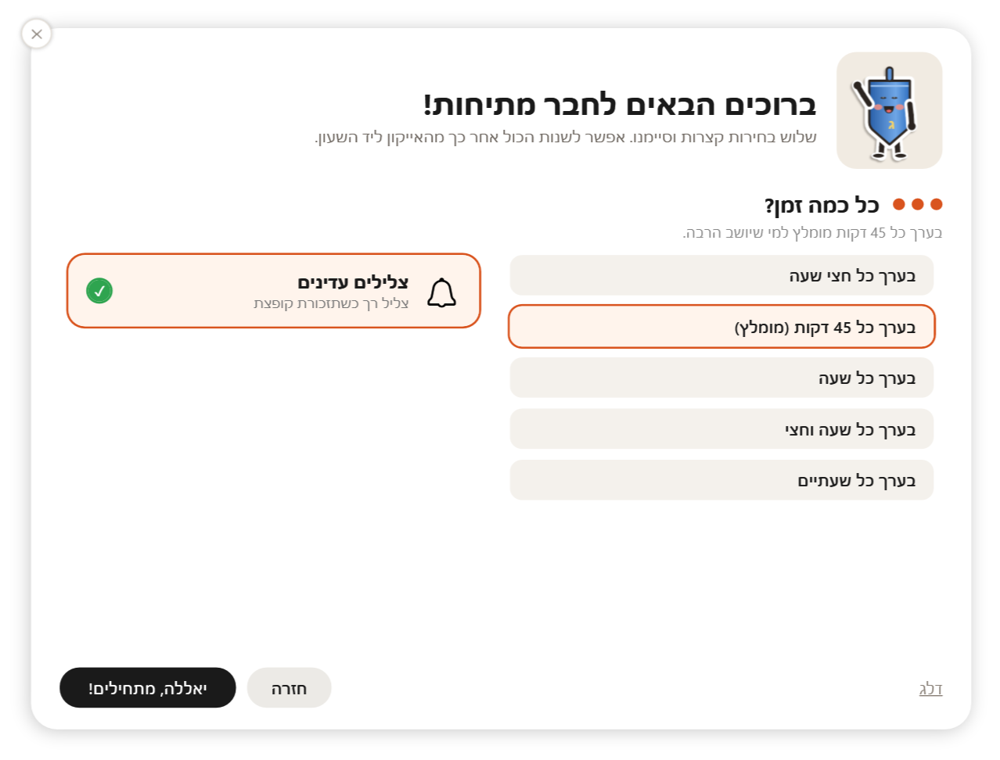
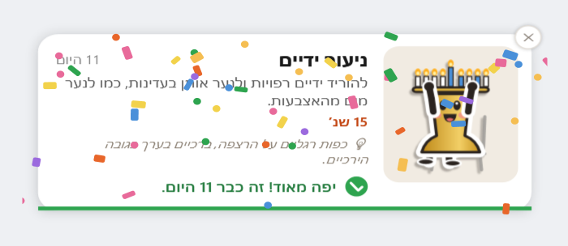
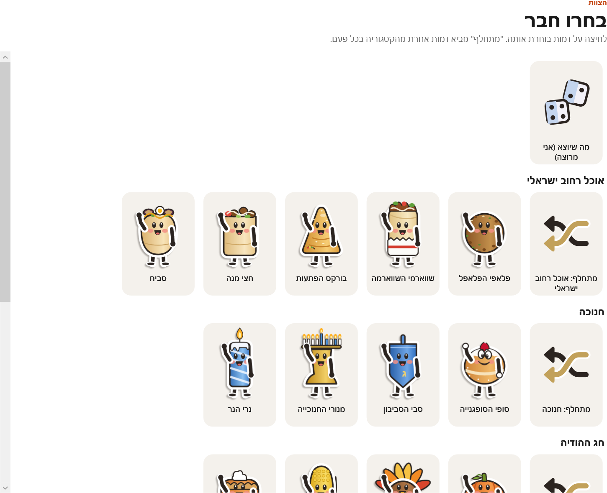

# חבר מתיחות 🧆🍝🕎

עברית · **[English](README.en.md)**

חבר קטן וחמוד למחשב (Windows) שמזכיר לך להתמתח, לשתות מים, לקום ולתת מנוחה לעיניים בזמן העבודה.
דמויות מונפשות מדגימות כל תרגיל, ואתם פשוט עושים כמוהן.

### [⬇️ להורדת התוכנה (StretchBuddy-Setup.exe)](https://github.com/tzvik/Falafel-strech-buddy/releases/latest/download/StretchBuddy-Setup.exe)

## התקנה (Windows 10 / 11)

1. **מורידים** את [StretchBuddy-Setup.exe](https://github.com/tzvik/Falafel-strech-buddy/releases/latest/download/StretchBuddy-Setup.exe).
2. **לוחצים עליו פעמיים.**
   ייתכן ש-Windows יציג הודעה *"Windows protected your PC"* (המחשב שלך מוגן), כי התוכנה עדיין לא חתומה דיגיטלית.
   לוחצים על **More info** (מידע נוסף) ← **Run anyway** (הפעל בכל זאת).
3. נפתח **אשף קצר של ברוכים הבאים** (אפשר גם ללחוץ "דלג"):
   בוחרים דמות ← מסמנים על מה להזכיר ← בוחרים כל כמה זמן והאם להשמיע צליל.
4. זהו. האייקון של החבר מחכה **ליד השעון** (אם הוא מוסתר, לוחצים על החץ `^`).
   **לחיצה ימנית** עליו פותחת את ההגדרות, **לחיצה כפולה** מקפיצה תזכורת מיד.

לא צריך הרשאות מנהל. התוכנה מותקנת רק למשתמש שלך ועולה אוטומטית עם Windows.
להסרה: **הגדרות ← אפליקציות ← אפליקציות מותקנות ← Stretch Buddy ← הסרת התקנה**.

## אשף ההגדרה

בהתקנה הראשונה נפתח אשף של שלושה צעדים. אפשר לפתוח אותו שוב בכל זמן מהתפריט: **הגדרה מהירה…**

| 1. מי יזכיר לך? | 2. על מה להזכיר? | 3. כל כמה זמן? |
|---|---|---|
|  |  |  |

## מה זה עושה

- **בערך כל 45 דקות**, פלוס מינוס קצת (לפי המלצות ארגונומיה: לזוז כל 30-60 דקות של ישיבה, ולשתות מעט ולעתים קרובות).
  אפשר לשנות: בערך כל חצי שעה / 45 דקות / שעה / שעה וחצי / שעתיים.
- הודעה קצרה ("הגיע הזמן **להתמתח!**"), ואז כרטיס עם תרגיל **אחד**. הדמות מדגימה אותו בזמן אמת.
- **חיצים** כתומים מראים לאן לזוז. בתנועות שלא רואים מקדימה (הכנסת סנטר, מתיחת גב עליון)
  **בועה קטנה במבט מהצד**, ליד הדמות, מראה את התנועה.
- התזכורת **נשארת על המסך עד שמגיבים לה**. כפתור אחד: **עשיתי**. בלחיצה: "יפה מאוד! זה כבר 3 היום",
  דמות שמחה, ומדי פעם **קונפטי**. **✕** סוגר אותה.
- 19 תרגילים: מתיחת גב עליון, הכנסת סנטר, מתיחת צוואר, סיבובי צוואר, סיבובי כתפיים, ידיים לצדדים, פיתול בישיבה,
  מתיחת שורש כף יד, ניעור ידיים, מנוחה לעיניים (20-20-20), נשימות עמוקות, עליות על בהונות, לקום,
  להסתובב וללכת, סיבוב הליכה, ושתיית מים.
- כל כרטיס עוסק בדבר אחד בלבד, עם טיפ מתאים (יציבה / מים / עיניים / תנועה). "איך עושים" פותח הסבר צעד אחר צעד.
- צלילים עדינים שמתאימים לתזכורת: מים נשפכים לכוס, חריקה עדינה למתיחות, צליל "עלית שלב" להפסקות של קימה והליכה,
  ו"אהה" רגוע למנוחת עיניים. אפשר להשתיק בלחיצה.
- אפשר **לגרור** את החלון לכל מסך, והוא זוכר את המקום.
- **עברית ואנגלית**.

## הגדרות (לחיצה ימנית על האייקון ליד השעון)

| הגדרה | אפשרויות |
|---|---|
| להזכיר עכשיו | מקפיץ תזכורת מיד |
| הגדרה מהירה… | פותח שוב את אשף ההגדרה |
| דמות | לבחור דמות בגלריה, "מתחלף" בתוך קטגוריה, או "מה שיוצא (אני מרוצה)" |
| שפה | עברית, English |
| סוגי תזכורות | מתיחות / שתיית מים / לקום ולזוז / עיניים ונשימה: לכל אחד לעתים קרובות, מדי פעם או כבוי |
| תדירות | בערך כל חצי שעה, 45 דקות (מומלץ), שעה, שעה וחצי או שעתיים |
| הפסקה לשעה, השתקת צלילים, איפוס מיקום החלון, יציאה | |

## הדמויות

- **אוכל רחוב ישראלי** (ברירת מחדל): פלאפל, שווארמה, בורקס הפתעות, חצי מנה, סביח
- **חנוכה**: סופגנייה, סביבון, חנוכייה, נר
- **חג ההודיה**: דלעת, הודו, תירס, פאי דלעת
- **פסטה**: ריגטוני, פנה, פרפאלה, רביולי, ספגטי, לזניה
- **מאפייה** (חבילת דוגמה): בייגלה, פיתה

### להוסיף דמויות משלכם

כמו חבילת סטיקרים בוואטסאפ: תיקייה עם קובץ `pack.json` ותמונות PNG או צורות פשוטות.
כל דמות מקבלת אוטומטית ידיים, רגליים, מצמוץ וכל אנימציות התרגילים.
כדי לשתף, מכווצים את התיקייה ל-zip; אחרים מוסיפים אותה מהתפריט: **דמות ← הוספת חבילת דמויות…**
החבילות נבדקות לפני הטעינה, כך שחבילה משותפת לא יכולה להריץ קוד. פרטים: [packs/README.md](packs/README.md).

אפשר גם לשים קובץ `tray-icon.png` בתיקיית התוכנה כדי להחליף את האייקון שליד השעון.

## למפתחים

PowerShell ו-WPF בלבד, אין מה להתקין.

| קובץ | מה יש בו |
|---|---|
| `rigatoni.ps1` | חלון התזכורת, הדמויות, האנימציות, הגלריה ואשף ההגדרה |
| `tray.ps1` | האייקון ליד השעון, הטיימר ותפריט ההגדרות |
| `i18n.json` | כל הטקסטים (עברית, אנגלית) |
| `packs\` | חבילות דמויות נוספות |
| `sounds\` | הקלטות מ-Pixabay (`.mp3`, כיוונון ב-`sounds.json`, קרדיטים ב-[CREDITS.md](sounds/CREDITS.md)) וצלילים מסונתזים |
| `installer\` | `build.ps1` בונה את `dist\StretchBuddy-Setup.exe` עם IExpress (מובנה ב-Windows) |

הרצה מהקוד: `powershell -ExecutionPolicy Bypass -File install.ps1` ·
תצוגה מקדימה: `rigatoni.ps1 -Demo drink -Who 8 -Lang he` · גלריה: `rigatoni.ps1 -Gallery` · אשף: `rigatoni.ps1 -Setup`

*בהשראת ההדגמה "Tony the Rigatoni" של Claude. נבנה עם Claude Code.*

## רישיון

קוד: MIT. צלילים: ראו [sounds/CREDITS.md](sounds/CREDITS.md).

