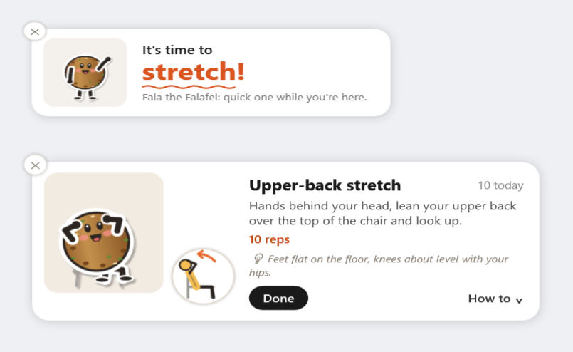
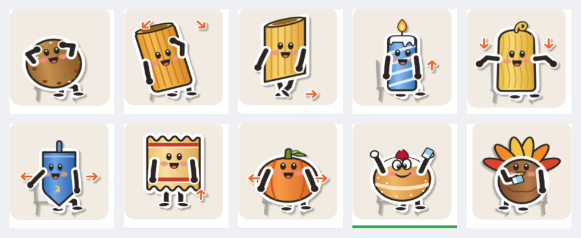

# Stretch Buddy 🍝🕎

A cute desktop buddy for Windows that nudges you to stretch, drink water, stand up and rest your
eyes while you sit at the computer. Animated characters act out each exercise, so you just copy them.

*Inspired by Claude's "Tony the Rigatoni" demo. Built with Claude Code.*

## What it does

- About **every 2 hours, at a slightly random time** (adjustable: ~1h / 1.5h / 2h / 3h). Not a nag.
- **Choose your reminder types**: Stretches, Water, Get up & move, Eyes & breathing, each Often / Sometimes / Off.
- **Subtle sounds** that match the reminder: water pouring, a gentle creak for stretches, an "ahh" for eye rest
  (recordings from Pixabay, see [sounds/CREDITS.md](sounds/CREDITS.md)); festive kits play their own little tune when
  you finish. One click to mute.
- A short toast ("It's time to **stretch!**"), then a card with one exercise. The character demos it live.
- Little orange **arrows** show which way to move.
- Finish one and you get a green "Nice! That's 3 today", a happy character, and now and then a burst of **confetti**.
- **Start** runs a countdown with a progress bar. **Snooze** brings it back in 5 minutes. Ignore it and it leaves quietly.
- 15 exercises: thoracic extension, chin tucks, neck stretch, shoulder rolls, seated twist, wrist & finger stretch,
  20-20-20 eye break, deep breaths, calf raises, stand up, walkaround, and water breaks.
- A small posture/water tip on every card.
- **Drag** the popup to any screen; it remembers the spot.
- **English and Hebrew** (right-to-left). More languages: add a block to `i18n.json`.
- **Tray icon**: remind me now, choose character, language, frequency, pause for an hour, reset position.

## The cast

Kits of characters. Pick one, a random one from a kit, or a surprise from everyone.

- **Israeli street food** (default): Falafel, Shawarma
- **Hanukkah**: Sufganiya, Dreidel, Menorah, Candle
- **Thanksgiving**: Pumpkin, Turkey, Corn, Pumpkin Pie
- **Pasta**: Rigatoni, Penne, Farfalle, Ravioli, Spaghetti, Lasagna
- **Bakery** (example pack): Bagel, Pita

### Add your own characters

Like a WhatsApp sticker pack: drop a folder into `packs\` with a `pack.json` and either sticker
PNGs or simple vector shapes. Every character automatically gets arms, legs, blinking and all the
exercise animations. See [packs/README.md](packs/README.md).

To share a pack, zip its folder. Others install it from the tray: **Character > Add character pack…**
Packs are checked before loading (drawing elements only, images stay inside the pack), so a shared
pack can't run code.

## Install

**Easy way:** download `StretchBuddy-Setup.exe` from the [Releases](../../releases) page and double-click it.
No admin rights needed. It installs for your user, starts with Windows, and shows up in
**Settings > Apps** so you can uninstall it like any app.

Windows may show "Windows protected your PC" because the installer isn't code-signed yet:
click **More info > Run anyway**.

**From source:** clone the repo and run `powershell -ExecutionPolicy Bypass -File install.ps1`.
Build the installer yourself with `installer\build.ps1` (uses IExpress, built into Windows).

## Files

| File | What |
|---|---|
| `rigatoni.ps1` | the reminder popup, the characters and their animations, the character gallery |
| `tray.ps1` | tray icon, timer and settings menu |
| `i18n.json` | all text (English, Hebrew) |
| `packs\` | extra character kits |
| `sounds\` | alert sounds: Pixabay recordings (`.mp3`, start/length/volume in `sounds.json`) + synthesized chimes (`.wav`) |
| `installer\` | builds `StretchBuddy-Setup.exe` |
| `state.json` | your settings (created on first run, not in git) |

Preview any exercise/character: `powershell -File rigatoni.ps1 -Demo drink -Who 8 -Lang he`

## License

MIT
