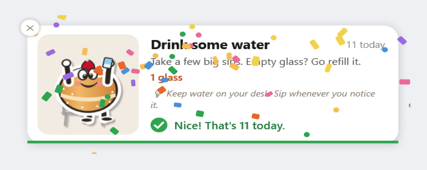
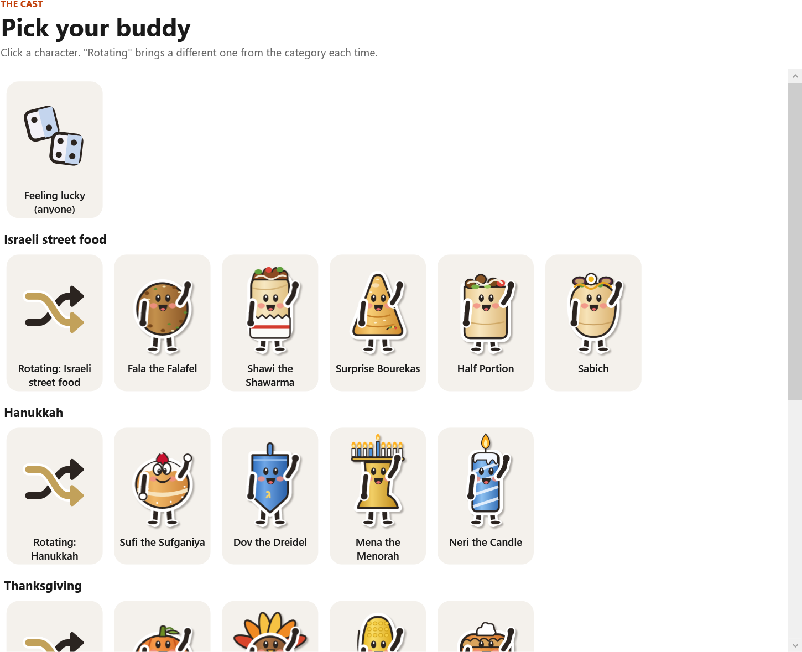

# Stretch Buddy 🧆🍝🕎

**[עברית](README.he.md)** · English

A cute desktop buddy for Windows that reminds you to stretch, drink water, get up and rest your eyes
while you work at the computer. Animated characters act out each exercise, so you just copy them.

*Inspired by Claude's "Tony the Rigatoni" demo. Built with Claude Code.*

### [⬇️ Download StretchBuddy-Setup.exe](https://github.com/tzvik/Falafel-strech-buddy/releases/latest/download/StretchBuddy-Setup.exe)

## Install (Windows 10 / 11)

1. **Download** [StretchBuddy-Setup.exe](https://github.com/tzvik/Falafel-strech-buddy/releases/latest/download/StretchBuddy-Setup.exe).
2. **Double-click it.**
   Windows may say *"Windows protected your PC"* because the installer isn't code-signed yet.
   Click **More info** → **Run anyway**.
3. A welcome message appears. Done. Look for the little rigatoni **next to the clock**
   (click the `^` arrow if it's hidden). **Right-click it** for settings, **double-click** for a reminder right now.

No admin rights needed. It installs for your user only, starts with Windows, and can be removed from
**Settings → Apps → Installed apps → Stretch Buddy → Uninstall**.

## What it does

- About **every 45 minutes**, give or take a little (ergonomics guidance: move every 30-60 min of sitting;
  drink little and often). Adjustable: ~30 min / 45 min / 1h / 1.5h / 2h.
- A short toast ("It's time to **stretch!**"), then a card with **one** exercise. The character demos it live.
- Orange **arrows** show which way to move; for moves a front view can't show (chin tucks, upper-back stretch)
  a small **side-view bubble** shows it.
- The reminder **stays on screen until you act on it**. One button: **Done**. You get a green
  "Nice! That's 3 today", a happy character, and now and then a burst of **confetti**. **✕** dismisses it.
- 19 exercises: upper-back stretch, chin tucks, neck stretch, neck turns, shoulder rolls, arms wide, seated twist,
  wrist & finger stretch, hand shake-out, eye break (20-20-20), deep breaths, calf raises, stand up,
  turn around & walk, walkaround, water breaks.
- Each card is about one thing only, with a matching tip (posture / water / eyes / movement).
- Gentle sounds that match the reminder: water pouring, a soft creak for stretches, a little "level up" for
  get-up breaks, an "ahh" for eye rest.
- **Drag** the popup to any screen; it remembers the spot.
- **Hebrew and English** (right-to-left supported).

## Settings (right-click the tray icon)

| Setting | Options |
|---|---|
| Remind me now | shows a reminder immediately |
| Character | pick one in the gallery, "rotating" within a kit, or "feeling lucky" (anyone) |
| Language | English, עברית |
| Reminder types | Stretches / Water / Get up & move / Eyes & breathing: each Often, Sometimes or Off |
| How often | about every 30 min, 45 min (recommended), 1, 1.5 or 2 hours |
| Pause for 1 hour, Mute sounds, Reset popup position, Exit | |

## The cast

- **Israeli street food** (default): Falafel, Shawarma, Surprise Bourekas, Half Portion, Sabich
- **Hanukkah**: Sufganiya, Dreidel, Menorah, Candle
- **Thanksgiving**: Pumpkin, Turkey, Corn, Pumpkin Pie
- **Pasta**: Rigatoni, Penne, Farfalle, Ravioli, Spaghetti, Lasagna
- **Bakery** (example pack): Bagel, Pita

### Add your own characters

Like a WhatsApp sticker pack: a folder with a `pack.json` and either sticker PNGs or simple vector shapes.
Every character automatically gets arms, legs, blinking and all the exercise animations.
Zip the folder to share it; others add it from the tray: **Character → Add character pack…**
Packs are checked before loading, so a shared pack can't run code. See [packs/README.md](packs/README.md).

## For developers

Plain PowerShell + WPF, nothing to install.

| File | What |
|---|---|
| `rigatoni.ps1` | the reminder popup, characters, animations, gallery |
| `tray.ps1` | tray icon, timer and settings menu |
| `i18n.json` | all text (English, Hebrew) |
| `packs\` | extra character kits |
| `sounds\` | Pixabay recordings (`.mp3`, tuning in `sounds.json`, credits in [CREDITS.md](sounds/CREDITS.md)) + synthesized chimes |
| `installer\` | `build.ps1` builds `dist\StretchBuddy-Setup.exe` with IExpress (built into Windows) |

Run from source: `powershell -ExecutionPolicy Bypass -File install.ps1` ·
Preview: `rigatoni.ps1 -Demo drink -Who 8 -Lang he` · Gallery: `rigatoni.ps1 -Gallery`

## License

Code: MIT. Sounds: see [sounds/CREDITS.md](sounds/CREDITS.md).
